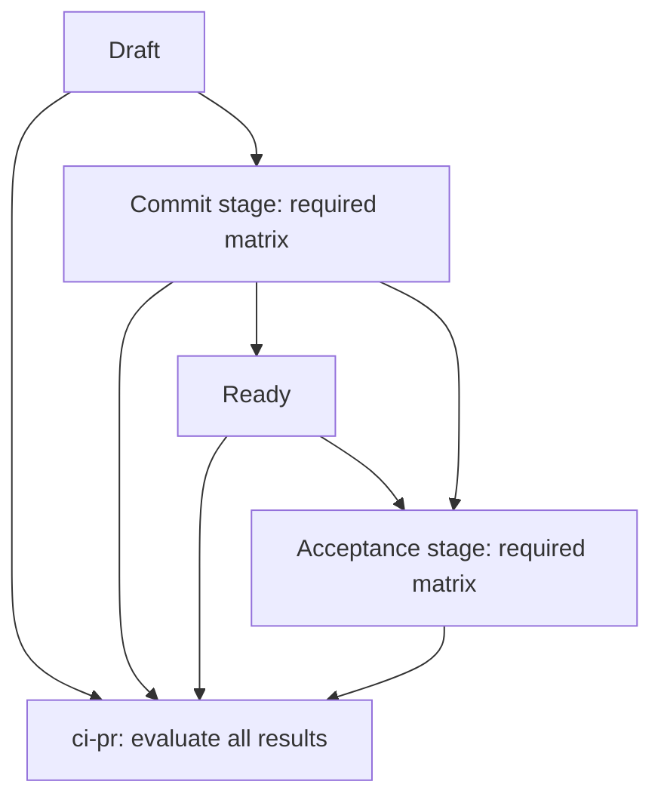

## Contents

- [Determine execution paths from requirements](#determine-execution-paths-from-requirements)
- [Staged CI adoption](#staged-ci-adoption)
- [Runners and shells](#runners-and-shells)

## Determine execution paths from requirements

For new workflows check who needs which results for which changes. For existing structures first read purpose, required check names, supported OS/runtimes, Secrets/publication permissions, deployment targets, and recovery. Start with small structures passing required validation.

### Events and jobs

- Choose `push`/`pull_request` by comparing validated commits and duplicate runs. For merge queues check required events such as `merge_group`. Do not use `pull_request_target` to bypass insufficient PR-test permissions.
- Match `workflow_dispatch` to manual operations, `workflow_call` to reuse, and `schedule` to recurring work. Check official target-event specifications for default-branch definitions and PR head versus merge ref.
- `needs` expresses actual dependencies. Do not unnecessarily serialize independent checks; check downstream behavior on upstream failure/skip. Separate cleanup/diagnostic-saving conditions from conditions treating mandatory validation as successful.
- Specify shells, working directories, dependency pinning, and appropriate timeouts. Check OS shell differences, service readiness, test isolation, and cleanup. Do not hide mandatory-test failures through indiscriminate retries or `continue-on-error`.
- Whole-workflow path/branch filters with required checks can leave them Pending. With job-level decisions/aggregation, verify necessary validation failures/cancellations propagate to final checks.

### Reuse and data handoff

Consider composite Actions for shared steps and reusable workflows for shared jobs/runner structures. Match existing boundaries; duplication alone does not justify splitting. Contract `workflow_call` input types, requiredness, defaults, outputs, and Secrets, checking caller mappings. Nested calls cannot increase permissions; explicitly check Secret forwarding. Choose `secrets: inherit` after confirming necessary scope.

Pass small values as outputs and files as artifacts; paths alone do not move files between jobs. Check generating commit, target OS/version, content identity, retention, and confidential data. Save only necessary diagnostics in logs/reports, excluding Secrets. Caches support reuse, not authoritative deployment artifacts.

### Deployment and recovery

Promote the same validated artifact between environments. Check job conditions/permissions, environment protection, concurrency conflicts, and responsibility for release decisions. `environment:` alone does not configure manual approval. Choose manual approval, Canary, or blue/green where risks/existing operations fit.

Define post-deployment health checks, observed failures, and recovery artifacts/configuration. Do not assume data migrations are as reversible as code rollback. Check deployment/recovery within existing scope; use `issue-management` for changed release conditions/permissions. Hand approved recovery changes/validation to `change-delivery`.

### Paths to validate

Select necessary events, forks, unrelated changes, dependency-job failures/skips, and cancellation as well as normal paths. Beyond static checks/existing tests, verify required checks, outputs/artifacts, and post-deployment state through authorized GitHub runs. State inaccessible protection settings or unexecuted deployment as unverified. For test design and cleanup, apply [Testing boundaries and cleanup](../../software-development/references/testing.md#no-tests-of-tests); retain deployment-identity, failure-propagation, and security outcomes without asserting internal helper/command sequences or self-testing application runners.

## Staged CI adoption

Apply this selected contract when a repository adopts shared staged CI; it is not a universal GitHub requirement. Keep orchestration identical across adopting repositories, with repository-specific commands and artifact handling in local composite Actions. Do not replace existing validation with a copied workflow that drops required checks or supported targets.

### Flows and check names

| Workflow file | Flow | Workflow name and final job/check name |
| --- | --- | --- |
| `ci-pr.yml` | Draft → Commit stage → Ready → Acceptance stage → final result | `ci-pr` |
| `ci-push.yml` | Commit stage → Acceptance stage → final result, on main pushes | `ci-push` |

Keep the file stem, workflow name, aggregate job ID, and emitted check name identical. Do not override the aggregate job's display name or share a generic `pass` check across workflows. Keep PRLint in its separate `prlint` workflow.

Ready means the Commit stage passed and the change is reviewable. It does not mean Acceptance passed or merging is approved. Acceptance failure may leave the PR Ready while the final check is unsuccessful. CI does not wait for review, approve, or merge PRs; retain existing review and merge responsibilities.

Start Acceptance through `needs` in the same run, after Commit and the PR's Ready operation. Do not depend on a later `ready_for_review` event. Main-push validation has no Draft/Ready operations. The following illustrates PR dependencies only, not a complete workflow; the final job evaluates all mandatory results even after failure:



### Local validation and artifact contract

Agree one configuration/input-output contract for local Actions before sharing orchestration: required build and acceptance matrices, stable target keys, runner selection, and the candidate artifact each acceptance leg consumes. Keep build targets distinct from acceptance kinds/runners so an additional integration or public-Action smoke test is not lost. Each repository supplies its own values and commands.

| Responsibility | Contract |
| --- | --- |
| Configuration | Preserve the repository's current required tests and supported platforms; compare its authoritative matrix and support documentation before changing coverage |
| Commit stage | Run applicable lint, unit tests, race checks, and builds; publish the built candidates and their identity manifest |
| Handoff | Record the actual built source SHA, source/run identity, target OS/architecture, and content digests; preserve the mapping from each acceptance leg to its producer |
| Acceptance stage | Download the candidate from that run, verify its manifest against the expected source/target and recomputed digests, and exercise that same product artifact without rebuilding it |

Distinguish the checked-out PR merge SHA from the PR head SHA when recording source identity. Fail missing, mismatched, or corrupt artifacts; a downloader warning is not a passing integrity check. Caches cannot substitute for this handoff. Artifact identity checks establish what was tested, not whether a PR is still the latest or mergeable.

### Events and concurrency

- Select code and base-change events/conditions explicitly. If handling `edited`, distinguish a changed base from title/body-only edits. Keep metadata-only PRLint separate from product validation.
- Title/body-only edits must not run product stages, change Draft/Ready state, or cancel queued/running code validation. Keep them out of the product concurrency group and do not let them publish a skipped/successful replacement for the product's required check. Job-level `if` guards alone do not isolate workflow-level concurrency or check results; verify the selected event routing and emitted contexts before adoption.
- Scope PR product concurrency by workflow and PR number, with `cancel-in-progress: true`; scope main-push concurrency separately by workflow/ref. Do not add custom HEAD/base freshness checks, latest-PR probes, rerun-generation tracking, stale-result suppression, or recovery coordination.
- Let GitHub events, rulesets, and settings decide freshness and merge eligibility. Concurrency limits overlapping work but is not an atomic latest-HEAD guarantee or a guarantee of dispatch order. Keep artifact identity verification separate.

### Final results, permissions, and adoption

Make the final job depend directly on every mandatory job, including configuration, state transitions, and both stage matrices where present. Use a status condition such as `if: always()` so upstream failure/skip does not skip the gate; explicitly require every mandatory dependency and matrix leg to have succeeded. An empty/incomplete required matrix, failure, cancellation, or unexpected skip must not become success. Do not hide mandatory failures with `continue-on-error`, optional-leg defaults, or a successful last stage. A canceled run may remain canceled without executing its final job; it is not a passing result.

Fork or Dependabot PRs lacking the permissions needed for Draft/Ready are unsupported by this policy and require human handling. Surface permission failures; do not swallow them, mark unsupported paths successful, or add elevated-token/privileged-event fallbacks. Retain the existing security, runner, and shell rules.

Changing required contexts needs separately authorized settings work. Keep the old required gate until the replacement has been published, verified, and configured, then remove it through the authorized migration. Do not replace this with runtime ruleset probes or weaken other protection conditions.

For later authorized workflow adoption, check normal PR/main flows, mandatory failure/skip/cancellation, metadata-only and base changes, artifact reuse/identity, and retained matrix coverage proportionately. Distinguish static checks from actual GitHub runs and unexecuted cases. Updating this guidance alone does not adopt it in any repository or change its workflows/settings.

## Runners and shells

Check these only when runners or shells relate to workflow design, changes, or review.

- Before selecting runners, check target `runs-on` label availability, matching candidate providers (GitHub-hosted/self-hosted), groups, and repository access. Do not infer provider from labels. If same-label self-hosted runners are candidates, especially for PR code, check shared-state/network/host-credential boundaries in [Safety](hardening.md); do not finalize solely from labels before confirming GitHub-hosted status.
- Even when `ubuntu-slim` is available, permanently use another runner only after confirming it cannot satisfy necessary processing. Habit, existing examples, or mere desire for performance are not exception reasons.
- For execution-time requirements, compare target-runner measurements with job timeouts in official material at decision time; other runners' times alone do not prove fit. Without measurements retain existing mandatory jobs if present and try representative jobs on nonmandatory trials for new candidates. This is temporary pending suitability, not a permanent exception.
- For exceptions check GitHub.com/GHES, visibility, and plan. On GitHub.com consult applicable [public-runner lists](https://docs.github.com/en/actions/reference/runners/github-hosted-runners#standard-github-hosted-runners-for-public-repositories) or [private-runner lists](https://docs.github.com/en/actions/reference/runners/github-hosted-runners#standard-github-hosted-runners-for-private-repositories). On GHES check its inventory without applying GitHub.com lists.
- Compare `ubuntu-slim` constraints, recording unmet requirements/concrete constraints in workflow comments or change descriptions. Check [official constraints](https://docs.github.com/en/actions/reference/runners/github-hosted-runners#single-cpu-runners) at decision time.
- When reporting runner choices, explicitly distinguish this skill's `ubuntu-slim` preference from universal GitHub requirements and official provision/constraint specifications. Record dated specification checks with the target decision.
- For new workflows or approved workflow-level shell migration, always specify top-level `defaults.run.shell: bash`. Step-only `shell: bash` does not satisfy this. For limited existing-workflow changes without approved shell migration, preserve existing shells and report/propose shell policy separately.
- Check Bash availability and command compatibility in every affected job. Where missing on self-hosted runners/containers, provide Bash-equipped runners/images if possible. For package-install steps using existing shells, explicitly specify a shell available before installation (for example `sh`); top-level Bash defaults also affect installation steps.
- If Bash cannot be provided and commands are POSIX-compatible, retain workflow-level Bash and specify `defaults.run.shell: sh` only for that job, recording absence as the reason. For jobs/steps contracted to PowerShell or another shell, retain top-level defaults and override job `defaults.run.shell` or step `shell` with available compatible shells, recording concrete requirements. These are local exceptions necessary for environments/command compatibility. If Bash-specific commands are necessary but Bash unavailable, ask the user which policy/requirements take precedence.
- Explicit `bash` and unspecified shells execute different commands. On Linux/macOS, unspecified shells use `bash -e {0}`, falling back to `sh -e {0}` without Bash; explicit `bash` uses `bash --noprofile --norc -eo pipefail {0}`. Job containers default to `sh` unless overridden. Check the current [workflow shell specification](https://docs.github.com/en/actions/reference/workflows-and-actions/workflow-syntax#defaultsrun) and [job container specification](https://docs.github.com/en/actions/reference/workflows-and-actions/workflow-syntax#jobsjob_idcontainer) for the target environment.
- When changing unspecified shells to explicit Bash, check pipeline status and existing handlers/output contracts. `pipefail` returns the last nonzero command's status in a pipeline. `errexit` does not immediately exit solely from failures in `if` conditions or nonfinal `&&`/`||` list commands; that exception does not apply after the final `&&`/`||`. Compare actual pipeline positions and surrounding branches with the [Bash pipeline](https://www.gnu.org/software/bash/manual/html_node/Pipelines) and [set builtin](https://www.gnu.org/software/bash/manual/html_node/The-Set-Builtin.html) specifications. Handle only intended nonzero statuses locally while preserving other failures. Record existing-job-contract reasons for job/step overrides.

```yaml
defaults:
  run:
    shell: bash

jobs:
  check:
    # Confirm provider, runner group, and repository access before selecting this label.
    # Label availability alone does not identify a GitHub-hosted runner.
    runs-on: ubuntu-slim
    steps:
      - name: Check shell
        run: printf '%s\n' "$BASH_VERSION"
```
